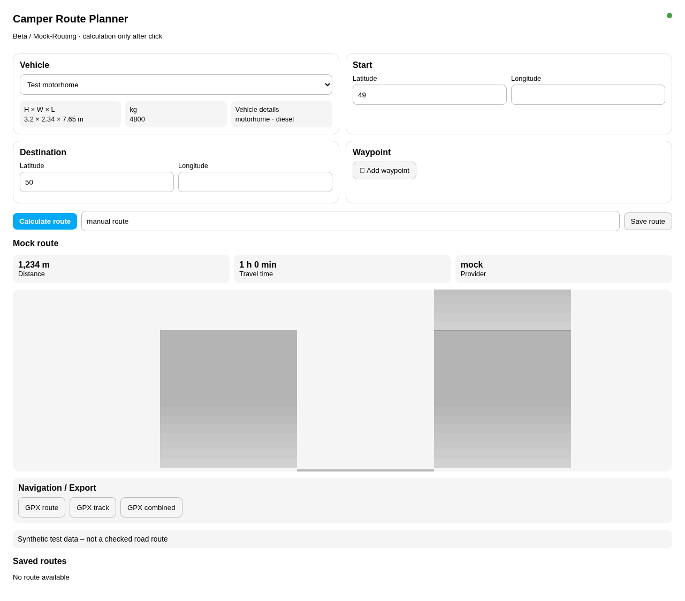

# Camper Route Planner


Deutschsprachige Home-Assistant-Custom-Integration zur manuellen
Routenplanung mit Fahrzeugprofilen, interaktiver Karte, gespeicherten Routen
und GPX-Export.

> **Status:** `v0.1.0` Stable. Die Lovelace-Karte ist für eine isolierte
> HA-2026.10.1-Fixture, Chromium und den praktischen iPhone-Navigationstest
> geprüft. Nakordoni-Motorhome-Routing bleibt ausdrücklich manuell, ohne
> automatische Fallbacks.
>
> **Aktueller Pre-release:** `v0.1.1-beta.13` verbessert die lokale
> Tankplanung und die iPhone-Bedienung. Stable bleibt `v0.1.0`.

[English version](README.en.md) · [Dokumentation](docs/)




## Bereits implementiert

- Fahrzeugprofile mit Höhe, Breite, Länge, Gewicht und Fahrzeugart
- Start, Ziel und Zwischenziele
- manuelle Berechnung ausschließlich nach Benutzeraktion
- CARTO-Kartenintegration mit SVG-Fallback
- deterministisches Mock-Routing für Offline-Tests
- Nakordoni-Motorhome-Routing mit konfigurierten Fahrzeugparametern
- Speicherung und Laden berechneter Routen
- GPX-Export als Route, Track oder kombiniert
- Navigationsübergabe an iOS-/Android-Karten-Apps und Desktop-Fallback; GPX-Export bleibt erhalten
- deutsche und englische UI-Texte
- dauerhaft sichtbare Leaflet-Karte mit Marker-Drag und Kartenauswahl
- GPS-Startpunkt je Fahrzeugprofil; Zoe nutzt standardmäßig `device_tracker.wohnmobil_zoe`
- Geoapify-Adresssuche und Reverse-Geocoding über den HA-Options-Flow (Backend-only, mockbar)

## Unterstützte Grenzen

- Die Routenberechnung wird ausschließlich durch eine Benutzeraktion gestartet.
- Externe Navigations-Apps können Strecken neu berechnen und Fahrzeugparameter
  ignorieren; für komplexe Wohnmobilrouten bleibt GPX der zuverlässige Exportweg.

Truck-Routing darf bis zur Verfügbarkeit und Prüfung des echten Motorhome-
Profils nicht als sichere Wohnmobilnavigation dargestellt werden. Ein
stiller Fallback von Motorhome auf Truck ist ausgeschlossen.

## Installation und Konfiguration

Die Stable-Version kann als HACS-Custom-Repository oder manuell nach
`custom_components/camper_route_planner/` installiert werden. Anschließend wird sie
über **Einstellungen → Geräte & Dienste** eingerichtet. Im Options Flow stehen
`Nakordoni` (intern `nakordoni_motorhome`) und `Mock (offline)` zur Auswahl.
Fahrzeugänderungen sind standardmäßig deaktiviert; Provider-/Key-Änderungen
verändern vorhandene Profile, IDs und Tracker-Zuordnungen nicht.

### Karten

Die Karte kann mit einer browsergeeigneten CARTO-Konfiguration betrieben
werden. Zugangsdaten gehören nicht in das Frontend, in Screenshots, Logs,
GPX-Dateien oder Git. Wenn keine Kartenkacheln verfügbar sind, zeigt die
Karte den integrierten SVG-Fallback.

### Routen und GPX

Die Berechnung wird ausschließlich über die Schaltfläche bzw. die explizite
Service-Grenze ausgelöst. GPS-Änderungen, HA-Start, Reload oder das Öffnen der
Karte starten keine Berechnung. Der GPX-Export arbeitet auf der gespeicherten
normalisierten Route und enthält keine Zugangsdaten.

### Geoapify-Adresssuche und Datenschutz

Die Phase-3B-Kandidatenimplementierung nutzt Geoapify Address Autocomplete über
eine Backend-WebSocket-Grenze. Der Geoapify-Key wird ausschließlich im
Home-Assistant-Options-Flow gespeichert und niemals an Lovelace, Browser,
Logs, Diagnoseexporte oder GitHub übertragen. Suchtexte werden an Geoapify
übermittelt, wenn die Funktion aktiviert ist; die Oberfläche zeigt deshalb
einen Datenschutzhinweis und Geoapify/OpenStreetMap-Attribution. Debounce,
Ergebnislimit, lokales Rate-Limiting und Cache reduzieren unnötige Abfragen.
Reverse-Geocoding löst GPS-, Karten- und verschobene Marker nach einer kurzen
Verzögerung in eine lesbare Adresse auf; identische Koordinaten werden aus dem
Cache bedient. Ohne Treffer oder Key bleiben Koordinaten als maßgebliche Daten
sichtbar und Karte, GPS und manuelle Koordinaten aktiv.

Die Stable-Version enthält die korrigierte Navigationsübergabe für iOS und
Android anhand des bewährten direkten HTTPS-Anchor-Musters aus Mobile Fuel
Stations, vollständige Fahrzeugverwaltungs-Übersetzungen, bereinigte Provider-
Auswahl, Mehrfahrzeugverwaltung, GPX-Route/Track/kombinierten Export und den
nicht-destruktiven Options Flow. Die Live-Routenprüfung und der iPhone-Test
wurden vom Nutzer erfolgreich durchgeführt; automatisierte Tests verwenden
weiterhin ausschließlich Mock-Daten und isolierte Fixtures.

## Nakordoni-Status

Jede Installation verwendet ausschließlich den persönlichen Nakordoni-
Developer-API-Key des Benutzers. Der Key wird im Home-Assistant
Config-/Options-Flow als Passwortfeld eingegeben und lokal in der Config Entry
gespeichert; er wird nie an Lovelace, Browser-Local-Storage, GPX oder Logs
übertragen. Erneuerung und explizites Entfernen sind über den Options Flow
möglich. Siehe [API-Key-Anbindung](docs/NAKORDONI-API-KEY.md).

Laut Support-Ticket #230 ist `GET /api/v2/data/truck-route` mit dem
vorhandenen Zugang zugänglich. Das Projekt hat dafür keinen Live-Aufruf
ausgeführt. Das Truck-Routing besitzt ein separates Tageskontingent (Explorer
10, Starter 300 Routen/Tag; Zusatzkontingente möglich).

`vehicle_type=motorhome` ist als Beta dokumentiert und wird nur über den
explizit sichtbaren Provider `Nakordoni` verwendet. Das Profil verwendet
7,65 m × 2,34 m × 3,20 m, 4,8 t und zwei Achsen; Lkw-Lenk- und Ruhezeitfelder
werden nicht übertragen. Der kontrollierte Laufzeitpfad verwendet den
persönlichen Key über den HA-Transport; Mock ist kein automatischer Fallback.
Das isolierte Werkzeug startet standardmäßig im Dry-Run; der
[Live-Testplan](docs/PHASE2I-LIVE-TEST-PLAN.md) begrenzt den ersten Tag auf
acht Abfragen.

OAuth/PKCE bleibt als spätere optionale Alternative vorbereitet. Der Client von
Mobile Fuel Stations wird nicht übernommen.
Jeder Nutzer verwendet seinen eigenen Zugang und sein eigenes Routing-
Kontingent. Die Surface-Registrierung im Nakordoni-Dashboard ist vorbereitet,
aber nicht in einem fremden Account durchgeführt.

Details: [Nakordoni-Planungsupdate](docs/NAKORDONI-PLANUNGSUPDATE-2026-10-16.md),
[API-Audit](docs/NAKORDONI-API-AUDIT.md),
[Phase-2F-bis-2I-Plan](docs/PHASE2F-2I-PLAN.md).

## Sicherheit und Einschränkungen

- keine produktiven Secrets oder Tokens im Repository
- keine direkten Browser-Aufrufe zu Nakordoni
- keine automatische Routenberechnung oder Mock-Fallbacks bei Providerfehlern
- keine automatische Routenberechnung
- unbekannte Restriktionen werden nicht als freie Strecke interpretiert
- Truck-Maut, Truck-Fahrverbote und Ruheplanung sind nicht automatisch auf
  private Wohnmobile übertragbar

## Entwicklung und Tests

```bash
PYTHONPATH=src:. python3 -m unittest discover -s tests -v
python3 -m compileall -q src tests custom_components
cd frontend
npm ci
npm test
npm run build
npm run test:e2e
```

Der Stable-Installations- und Testnachweis steht in
    [docs/releases/v0.1.0.md](docs/releases/v0.1.0.md). Hassfest und
GitHub-seitige Validierung werden über
`.github/workflows/validate.yml` geprüft; der öffentliche Repository-Stand wird
durch GitHub Actions validiert. Die Installation in produktiven HA-Systemen
erfolgt weiterhin manuell durch den jeweiligen Betreiber.

## Roadmap

1. Stable `v0.1.0` ist veröffentlicht und bleibt als eigenständige
   Rückfallbasis erhalten.
2. Weitere Funktionen werden erst nach einem separaten Änderungsauftrag
   entwickelt.
3. Eine Migration zur inzwischen eingestellten SmartCamper Suite ist nicht
   Bestandteil dieses Releases; die Suite bleibt nur als historisches,
   stillgelegtes Repository erhalten.

## Nakordoni Motorhome (Anbieterstatus)

Der Provider `nakordoni_motorhome` ist der interne Laufzeitpfad hinter der sichtbaren Bezeichnung `Nakordoni`. Der Anbieterstatus des Motorhome-Profils kann weiterhin Beta sein; Verkehrszeichen und geltende Vorschriften haben Vorrang. Es gibt keine automatische Umschaltung vom Mock-Provider.

OAuth/PKCE bleibt als spätere optionale Alternative vorbereitet. Der
OAuth-Client von Mobile Fuel Stations wird nicht verwendet.

Routendaten werden mit [Data by nakordoni.eu](https://nakordoni.eu) attribuiert. Die Routing-API ist offiziell unter `nakordoni.eu` dokumentiert; OAuth und Account Usage unter `api.nakordoni.dev`. Details: [Phase 2H](docs/PHASE2H-IMPLEMENTATION.md), [API-Hosts](docs/NAKORDONI-API-HOSTS.md), [OAuth](docs/NAKORDONI-OAUTH.md), [Kontingente](docs/NAKORDONI-QUOTAS.md), [Maut](docs/NAKORDONI-TOLLS.md).

## Lizenz

MIT. Siehe [LICENSE](LICENSE).
